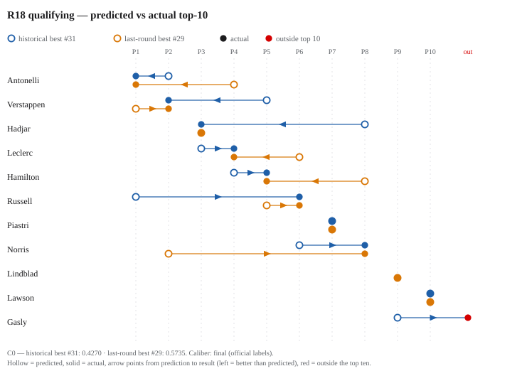
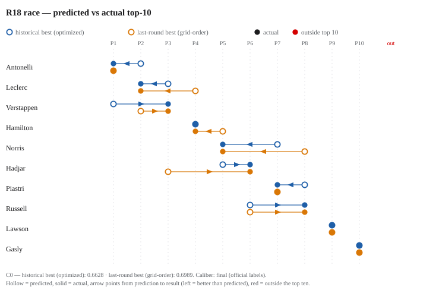

# f1-forecast-lab

A forecasting research project on the 2026 Formula 1 season: predicting the top ten of each qualifying session and race, round by round, on a fixed scoring scale with traceable evidence — archiving every prediction, every decision, and every failure. This repository holds the complete write-up and the reproduction materials.

It is not a "we predict accurately" showcase. It cares more about three questions: how a forecasting method can honestly say "we don't know" when the evidence is thin; how a model behaves once frozen and exposed to real races; and, when the data disagrees with expectations, how to put the mistake on the record instead of quietly patching it.

## How the research works

- **Two model lines.** The qualifying line runs 31 candidates in parallel on one frozen scoring scale, with out-of-window rounds as continuing checks. The race line starts from a grid-order baseline, changes design after feature diagnosis, and enters prospective validation with frozen weights. The two lines are independent; their scores are never compared across lines.
- **One scale built from fan intuition.** There is no off-the-shelf score for "a good predicted top-ten list", and everyone who follows the sport has an intuition that no one can write down as a formula. C0 treats that intuition as data to mine: an 84-question formal interview (every ruling recorded verbatim) turned vague comparisons into explicit statements; a blind questionnaire (question order frozen before answering, model scores never visible) collected preferences; the answers became machine-checkable constraints, and a solver found the parameter set satisfying all of them — with a proof that the feasible set is non-empty. **Every weight in C0 is therefore not tuned; it is the solution to a declared set of preferences.** The structure is three weighted parts — exact-position (45%), membership (35%), internal order (20%). Verifiable design decisions include: a disqualified driver is never treated as "P11" but gets a bounded mirror correction (worth at most 0.003 of the total); scores may go negative (an R11 candidate scored -0.0266); the combo-bonus shape was verified by exhaustive enumeration over 1,024 hit masks. The scale itself was audited: R08 revealed an anchor that made "missing only P1" cost 0.0358 more than intended, and the old anchor was retired. Since then the scale is frozen — only models change. Every "which is better" statement in this report presumes that freeze (full parameter provenance in Chapter 05).
- **Humans decide.** AI handles proposals, execution and evidence checks; every freeze and every rejection was decided by a human. New ideas go through isolated experiments first; serious candidates go through pre-registered blind tests; a gain below the quantitative threshold never enters the mainline.

<!-- LATEST:BEGIN -->
## Latest round: R18 · United States Grand Prix (2026-10-25)

### Qualifying

| Model | Predicted top-10 | C0 |
| --- | --- | ---: |
| Historical best — #31 slot ensemble | Russell · Antonelli · Leclerc · Hamilton · Verstappen · Norris · Piastri · Hadjar · Gasly · Lawson | 0.4270 |
| Last-round best — #29 (lambdamart_n200) | Verstappen · Norris · Hadjar · Antonelli · Russell · Leclerc · Piastri · Hamilton · Lindblad · Lawson | 0.5735 |
| Actual | Antonelli · Verstappen · Hadjar · Leclerc · Hamilton · Russell · Piastri · Norris · Lindblad · Lawson | — |

### Race

| Model | Predicted top-10 | C0 |
| --- | --- | ---: |
| Historical best — optimized (606117e) | Verstappen · Antonelli · Leclerc · Hamilton · Hadjar · Russell · Norris · Piastri · Lawson · Gasly | 0.6628 |
| Last-round best — grid-order baseline | Antonelli · Verstappen · Hadjar · Leclerc · Hamilton · Russell · Piastri · Norris · Lawson · Gasly | 0.6989 |
| Actual | Antonelli · Leclerc · Verstappen · Hamilton · Norris · Hadjar · Piastri · Russell · Lawson · Gasly | — |

Evaluation caliber: final (official labels).

## Next round: R19 · Mexico City Grand Prix (2026-11-01)

### Qualifying

| Model | Predicted top-10 |
| --- | --- |
| Historical best — #31 slot ensemble | Antonelli · Russell · Hamilton · Leclerc · Verstappen · Norris · Piastri · Hadjar · Lawson · Gasly |
| Last-round best — #29 | Russell · Verstappen · Antonelli · Norris · Piastri · Hamilton · Leclerc · Gasly · Hadjar · Lawson |

Qualifying forward archived: 2026-10-26T01:42:44+00:00

### Race

Not generated yet (waiting for the starting grid).

_Auto-updated from the private data mirror. Prospective = archived before the session; retrospective replay = computed after the race._
<!-- LATEST:END -->

## Headline results (details in Chapter 07)

- **Race line.** In the three real rounds after the weight freeze (R12–R14), the model beat the grid-order baseline every time — 0.5780 vs 0.4669 on three-round means (2026-09-20 caliber). The margins are uneven: +0.15, +0.14, +0.04. In R13 at Monza the model put Antonelli — penalized to the back of the grid — first, and he went on to win the race (7.2).
- **Qualifying line.** 31 candidates (numbers are IDs, not rankings) competed round by round on the same scale. On the 2026-09-26 scorecard (caliber v3, decision log entry 18) — recomputed over R03–R14 under the seat-rotation policy of entry 12 — the slot ensemble #31 leads at 0.4649 (0.5033 in the seven in-window rounds, 0.4112 across the five out-of-window rounds), and every candidate now scores on every round: the mid-season line-up change is modeled, not dodged.
- **Two rejections, one reversal** (Chapter 09): the constructor-strength correction — gain +0.007, below the +0.010 threshold, with one placebo-event control outgaining the real-event group — stays out of the mainline and becomes a pre-registered blind test. The name-list mechanism was ruled out entirely on September 5 (entry 8), then reversed on September 20 (entry 12): a fail-closed seat-event registry now models team switches and substitutes, and every qualifying cell scores again.

## Reading paths

| Chapter | Content |
| --- | --- |
| [research/01](research/01-origins.md) | Origins: why the project started over |
| [research/02](research/02-plan.md) | The research plan and its phases |
| [research/03](research/03-survey.md) | Survey: 45 method records and the feasibility gate |
| [research/04](research/04-methodology.md) | Method and data discipline |
| [research/05](research/05-scoring-system.md) | The C0 scoring system: provenance of every parameter |
| [research/06](research/06-model-lineage.md) | Full lineage of both model lines |
| [research/07](research/07-results.md) | Results: scorecards and prospective rounds |
| [research/08](research/08-discussion.md) | Discussion: limits, work in flight, open questions |
| [research/09](research/09-decision-log.md) | Decision log: twenty-one entries |
| `appendix/` | Data sources, reproduction guide, scorecard index, glossary, timeline, process & collaboration |

Results only: Chapters 07 + 08. To reproduce: Appendix B (guide) + Appendix C (scorecard index).

## Code and data

- **Repository layout.** `src/`, `scripts/`, `tests/` hold the selected code (data pipeline, the scoring scale with all 31 candidates, the frozen race model, reproduction entry points). `data/` holds the cleaned data the pipeline reads; `docs/` the official-label manifests; `predictions/` every archived scorecard (all C0 scores) plus the v1.6 prediction archive; `research/` and `appendix/` the report; `zh/` (git-ignored) keeps the Chinese originals.
- **Tests**: **265 of 289 pass** (`PYTHONPATH=src python3 -m pytest tests -q`); the 24 failures are end-to-end integration tests requiring the full raw archive, which is not distributed.
- Selection and de-identification method: `SELECTION.md`.
- License: code MIT (`LICENSE`); text CC-BY-4.0 (`LICENSE-docs`).

## Status

This is research in progress, with no fixed endpoint. In flight: **practice sessions — tested and closed (September 20)**. The models use zero practice data (verified entry by entry, entry 11); the proposed experiment later ran and settled the fan controversy with a split verdict: practice pace correlates strongly with qualifying (ρ=0.886, positive in 14/14 rounds — the "look harder" side was right about the signal), but it is redundant with recent form and adds no model gain (all seven replacement ablations below the +0.010 bar — the skeptics were right about the model). The kept-open race-side variant was tested the same day and closed with it: the residual correlation is real (fleet -0.604) but converts to nothing (+0.0006 at best) — correlation is not model increment, and the feature line is now closed on both sides. Also in flight: the blind test for the constructor-strength correction (trigger rounds R14/R15, criteria pre-registered; the R14 trigger reading came in at exactly zero — no carrier metric moved — and the R15 verdict stage was retired by ruling with the whatif experiment line before running, entry 19); the seat-rotation policy, which landed on 2026-09-20 and superseded the "no mechanism" ruling (decision log, entry 12) — both scorecards were recomputed the same day, and R15 (Baku) is the first forward round under it; the race model also survived a same-day formula-slot audit — all 204 sibling variants of its racecraft feature were tried in its slot, and the incumbent finished first (entry 15); the pre-race evidence term, zero all season by design, retired on September 23 after a full reconstruction showed no model increment (entry 16); a deeper "dynamic roster" redesign remains registered but not started; the race model's grid input was corrected to the official post-penalty starting order (the FIA starting-grid documents archived per round, entry 21); R15 and R16 have run and their data and labels are archived in full (the label authority covers qualifying R01–R16 and race R10–R16); the recency-scaling exploration closed with a three-layer negative result (entry 20); and the data tooling was promoted to standing scaffolds (the FIA transcriber parameterized, the label manifests compiled with loud-failure checks, the weekly refresh now a single eight-step command, entry 21). The lap-time layer (conditions not yet met). Written as of 2026-09-18; updated 2026-09-20 (seat-rotation recompute, entry 12; the practice-signal line closed on both sides, entries 13–14; the formula-slot audit, entry 15; the evidence component retired, entry 16); updated 2026-10-08 (entries 17–21: the slot-ensemble discrepancy explained, the qualifying caliber moved to v3, the R15 blind test abandoned with the whatif line closed, the recency-scaling line closed, the race grid caliber switched), covering through R16.
